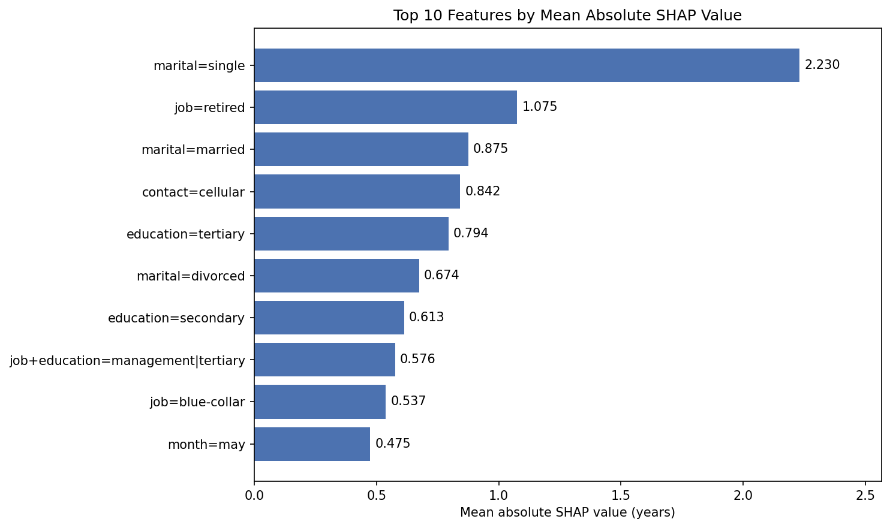
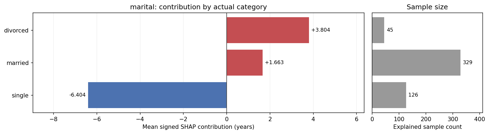
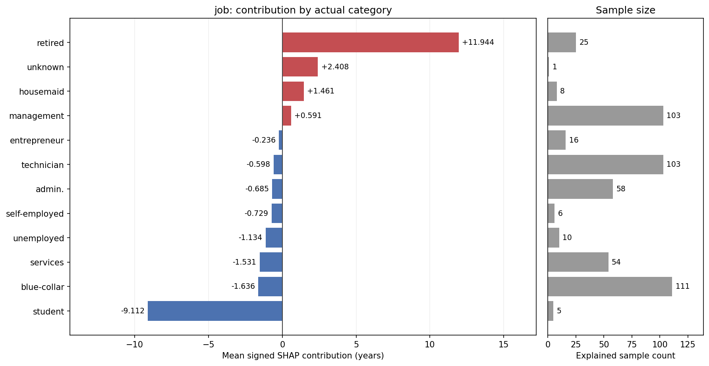
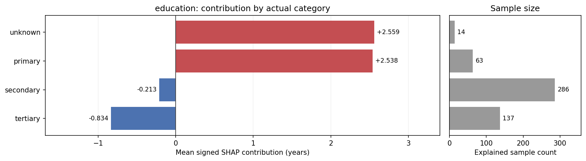
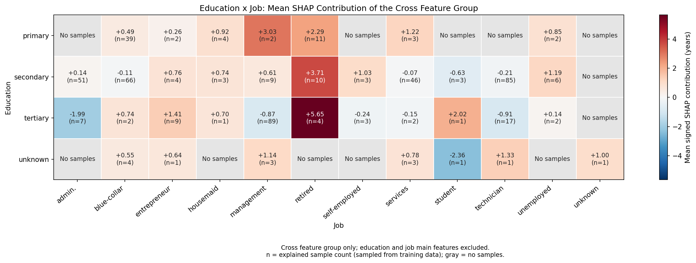

# 实验报告

## 1 模型说明

本项作业采用的模型为：**带 $L2$ 正则化的多元线性回归**，即
$$
\hat{y} = Xw+b
$$
其中，$X$ 为特征矩阵，$w$ 为各特征的权重，$b$ 为偏执。$\hat y$ 为模型针对给定输入特征计算得到的预测年龄，训练目标是让预测年龄不断接近真实年龄。为了防止过拟合，模型采用了 $L2  $ 正则化，默认系数为 $1.0$ ，因此目标函数为：

$$
\sum(Xw+b-y)^2 + \alpha\sum(w^2)
$$
模型直接采用正规方程求解，调用 `numpy.linalg.solve()` 直接求解权重和偏执，不需要进行迭代学习。

## 2 特征工程

### 数值特征标注化

提取了所有数值型的特征，计算数据集上，所有数值型特征的平均值和标准差，然后进行标准化处理：

$$
X_{std}=\frac{X-\mu}{\sigma}
$$
其中，数据集的缺失值用均值来填补。

### 新增特征“是否有联系”

对于 `pdays` 特征，其值大于等于 $0$ 时表示距离上次联系的时间距离，值为 $-1$ 时表示此前未联系。但“未联系”与“上次联系的距离”不应当统一考虑，“从未联系过”对预测的影响显然是不同的。因此考虑新增 `has_previous_contact` 特征，当 `pdays` 为 $-1$ 时值为 $0$，否则为 $1$。

### 增加对数特征

对于数值跨度较大的特征，例如 `balance` 和 `duration`，考虑捕捉其非线性关系，因此在保留原始特征的同时，考虑增加其对数特征：

$$
balance_{log} = sign(balance) \times \log(1+|balance|) \\
duration_{log} = \log(1+duration)
$$

### 类别特征交叉

当前模型只能单独考虑各个特征对预测年龄的作用，但实际上考虑到在不同 `education` 下，`job` 的作用可能不同，以及在不同 `loan` 下，`housing` 和 `default` 的作用也不同等等因素。因此对已有特征通过笛卡尔积构造新特征：`job × education` 和 `default × housing × loan`，从而让模型学习到不同特征组合对年龄预测的差异。

### 独热编码

对原始类别和交叉类别特征进行独热编码，使得模型能够理解类别。

## 3 分析结论

### 设置

考虑计算开销，本作业采用 numpy 的默认随机数生成器（seed=42）随机抽取 $700$ 条数据，其中前 $200$ 条作为背景数据，后 $500$ 条作为解释数据。所有数据使用模型原有的预处理，再通过 `shap.LinearExplainer`，结合模型的权重、偏置和 `Independent` 背景设置计算 SHAP 值。

### 所有特征的平均绝对 SHAP

通过各编码列的平均绝对 SHAP 值比较重要性，可以看出婚姻状态、职业、教育程度和联系方式的影响较大。其中，`marital=single` 通常降低预测年龄，`job=retired` 通常提高预测年龄。职业与教育的交叉项也有较明显的贡献，说明模型利用了这两个字段的组合信息。平均绝对 SHAP 最高的前十个特征如下表所示：

可见对于预测年龄来说，最核心的特征为：**martial, job 和 education**。

### 核心特征的 SHAP 分析

> 本节选取了 martial, job 和 education 三个主要特征做具体的 SHAP 分析。

#### 婚姻特征 martial

婚姻状态共 $3$ 个值，并且呈现出明显差异。
未婚（single）的平均 SHAP 贡献为 $-6.404$ 岁，而已婚（married）和离异（divorced）分别是 $1.663$ 和 $3.804$ 岁。未婚状态为负向贡献，模型更容易将其作为低年龄的信号，而已婚和离异状态则相反。
同时发现婚姻特征各个值的分布并不均匀，单身状态明显更多。

#### 职业特征 job

不同于婚姻特征，工作特征具有更大的基数。经过 SHAP 分析计算发现，其中大部分工作状态对预测结果的影响较小。重点关注 `student` 和 `retired`，发现分别是低年龄和高年龄的重要信号。

#### 学历 education

学历呈现出教育程度提高、贡献逐渐降低的模式。中等学历和高等学历对年龄预测有一定的负向贡献，而小学学历则是对高年龄较强的信号。在本抽样数据中，未知状态的占比相对高一些，但代表信息未知因此不能作为一个等级进行比较。

### 交叉特征的 SHAP 分析

对 `education × job` 特征绘制了热力图，能够清晰发现，`tertiary + retired` 更能够作为高年龄的信号，并且在已知 `retired` 下，不管学历如何都对年龄有正向贡献，与之前对学历的独立分析形成对比，凸显交叉特征的作用。
当职业为 `management` 时，单独计算 SHAP 值为 $0.591$，但是作为交叉特征时，发现 `managment + primary` 的组合是高年龄的信号。
以上实例都表明，`education × job` 这样的交叉特征对模型预测年龄具有较大贡献。

## 4 特征实验

### 新增特征 `pdays`

## 5 参考声明

`model.py` 和 `solution.py` 的实现主要为学生完成，其中 bug 修复和代码审查由 ChatGPT 辅助，部分特征工程工程由 ChatGPT 提出和实现，已在文件注释中标注。
`analysis.py` 借助了 ChatGPT 辅助完成，其中用于分析和计算的函数由学生完成（全写在 `main` 函数中，由 ChatGPT 将代码封装为 `ShapAnalysis` 类，便于代码的查看和维护。调用 `matplotlib` 包进行绘图的工作主要由 ChatGPT 完成。
`report.md` 由学生独立撰写。
